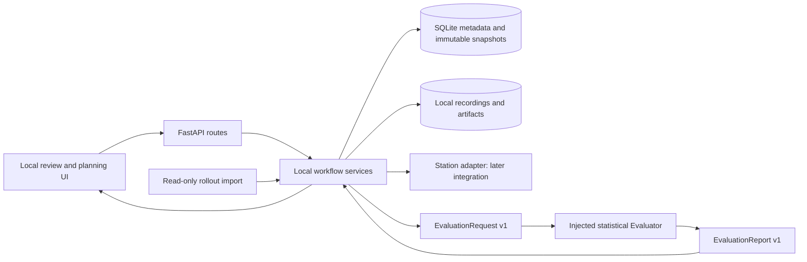

# DreamLabHack — local application and integration branch

This is **tureisD's local application branch**, `codex/local-app`, for Teach it a
task / Dream-FDE Studio. It will receive the statistical evaluation teammate's
work before the combined feature is merged into the larger project on `main`.

## What exists today

This is an executable architecture scaffold, not the finished application.

- Python 3.12 package with a reproducible `uv.lock` and separated dependency extras.
- Shared Pydantic request/report models and a pure `Evaluator` protocol.
- FastAPI health, capability, and evaluation-boundary routes.
- Contract and API integration tests, plus Windows/Linux CI configuration.
- Explicit directories and implementation responsibilities for local services.

**Not implemented:** rollout import, SQLite repositories, human labeling UI,
station control, statistical inference, sequential stopping, cloud training, and
checkpoint promotion. The evaluation route returns HTTP 501 until an engine is
injected. A successful `/health` response means only that this scaffold is running;
it says nothing about a robot, database, cloud account, or checkpoint.

## Branches and ownership

| Branch | Owner / responsibility | Destination |
| --- | --- | --- |
| `main` | Shared foundation, then final team integration | Team release workflow |
| `codex/local-app` | tureisD: local API, files, storage, import, labels, UI, and integration | `main` |
| `codex/stat-eval` | Teammate: statistical engine, validation, uncertainty, verdicts, report generation | `codex/local-app` |

```text
main (shared base)
  └── codex/local-app (local application and integration)
        └── codex/stat-eval (evaluation implementation)

Merge: stat-eval -> local-app -> main
```

The statistical branch starts from this scaffold, not an unrelated repository.
Its detailed assignment lives in `src/dreamlab/evaluation/README.md`, added on
that branch. Keep this root README as the combined project's guide, so merging
the handoff does not replace your local documentation.

### Change boundaries

- Local owner: `src/dreamlab/local/`, `web/`, `tests/local/`.
- Evaluation owner: `src/dreamlab/evaluation/`, `tests/evaluation/`.
- Joint review: `src/dreamlab/contracts/`, `tests/contracts/`, `tests/fixtures/`,
  `pyproject.toml`, `uv.lock`, CI and interface documentation.
- Local code owns persistence and hardware access. Evaluation code accepts a
  complete JSON-compatible snapshot and returns a report; it has no DB or robot
  dependency. The frontend never computes promotion criteria.

The names in shared models are the initial integration contract, not a claim
that Dream Labs' raw files already have these fields. Verify their actual format
with pilot recordings before implementing an upstream adapter.

## Architecture



There is one Python distribution, `dreamlab-hack`, with three component namespaces.
The contract is framework-independent apart from Pydantic. Local imports contracts;
evaluation imports contracts. Neither imports the other's implementation.

The current route calls the protocol directly as a small integration seam. The
full local application will call it through an evaluation service that loads and
freezes inputs, writes the result, and exposes job status. Long simulations belong
in durable background jobs, not a browser request or a DB transaction.

## File structure

```text
pyproject.toml / uv.lock          Package, optional extras, reproducible dependencies
src/dreamlab/
  contracts/
    models.py                    TaskSpec, plan, trial, request, report
    evaluation.py                Evaluator protocol and unavailable exception
  local/
    __main__.py                  Loopback development server
    api.py                       Runnable route scaffold
    importers/README.md          Raw rollout adapter assignment
    storage/README.md            SQLite repository/migration assignment
    services/README.md           Task, labels, plan and report orchestration
    station/README.md            Read-only status first; hardware integration later
  evaluation/
    __init__.py                  Reserved namespace; teammate implements here
web/README.md                    React UI boundary; no UI implementation yet
tests/
  contracts/                     Boundary validity and round-trip tests
  local/                         API behavior and dependency injection tests
  fixtures/evaluation_request.json  Synthetic, hand-reviewable contract example
docs/
  contracts.md                   Field meanings and semantic validation boundary
  branching.md                   Worktrees, sync, PR targets, and merge checklist
.github/workflows/ci.yml          Cross-platform checks
```

Directories containing only a README are deliberately reserved implementation
areas, not modules that already implement those features. The statistical branch
adds its engine entry point, method/reporting directories and detailed handoff.

## Install and run

Prerequisites: Git and [uv](https://docs.astral.sh/uv/getting-started/installation/).
uv can download Python 3.12; no global Python/package changes are required.

```powershell
git clone https://github.com/tureisD/DreamLabHack.git
cd DreamLabHack
git switch --track origin/codex/local-app
uv sync --locked --all-extras --group dev
uv run --locked --all-extras dream-local
```

Use `http://127.0.0.1:8000/docs` for the interactive API and
`http://127.0.0.1:8000/health` for a health check. Stop the server with Ctrl+C.
The same commands work in a POSIX shell. If the branch already exists locally,
use `git switch codex/local-app` instead of creating another tracking branch.

Local-only dependency setup is available with `uv sync --locked --extra local
--group dev`; run commands with the same extra. The full commands above install
both components' dependencies and run all shared checks. The previous
`requirements-dev.*` files were replaced by `pyproject.toml` and `uv.lock`; do not
maintain two dependency sources.

### Current endpoints

| Endpoint | Behavior |
| --- | --- |
| `GET /health` | Liveness and explicit `stage: scaffold` |
| `GET /api/v1/evaluation/capabilities` | Contract version and whether an engine was injected |
| `POST /api/v1/evaluations` | Validate the request; delegate to injected evaluator or return 501 |

`evaluator_configured` means injected, not statistically validated. Future engine
capabilities should describe supported designs/methods explicitly. A malformed
request returns 422. A well-formed but statistically unsuitable dataset belongs
in a `not_evaluable` report, not an invented numeric result.

Example request, after starting the server:

```powershell
Invoke-RestMethod -Method Post -Uri http://127.0.0.1:8000/api/v1/evaluations `
  -ContentType application/json -InFile tests/fixtures/evaluation_request.json
```

HTTP 501 is expected before integration. Do not mistake this fixture (four synthetic
trials) for evidence of statistical power or real-world robot improvement.

## Local implementation sequence

1. **Read-only import.** Get a real pilot rollout and write format adapters. Keep
   raw input intact; normalize identifiers, units and optional telemetry. Test
   malformed files, duplicate imports, missing cameras and partial recordings.
2. **Persistence.** Add migrations and repositories with transactions, foreign
   keys and unique keys. Separate episodes from label revisions. Do not store
   large footage in SQLite. Store source checksums and schema versions.
3. **Review and human labels.** Link video timestamps and logs to a trial. Keep
   success/failure/unknown/invalid distinct, preserve reviewer identity and reasons,
   and append corrections rather than silently rewriting old reports.
4. **Task and experiment planning.** Freeze task version, success rule, scenarios,
   reset protocol, checkpoint pair, trial budget and analysis design. Record seed,
   actual order and sessions. A planned setup is not proof of a successful reset.
5. **Evaluation handoff.** Export an `EvaluationRequest`, preserving every attempt.
   Inject the teammate's engine, persist its input snapshot/checksum and report,
   and display outcome counts, effect, uncertainty, limitations and trial links.
6. **Station/UI integration.** Add verified status reads, then explicitly supervised
   trial execution if needed. Build the React review/planning UI under `web/`.
   Start with fixed fixture replay so development is possible without hardware.
7. **Recovery and team integration.** Add durable jobs when necessary, restart
   recovery, disk-space handling and readable errors. Demonstrate the complete
   local-to-evaluation flow before merging this branch into `main`.

Keep each stage in a small reviewable commit. The evaluation owner implements the
math and method eligibility; the local owner collects the evidence it requires.
If a required field cannot be measured, preserve that uncertainty and coordinate
rather than fabricating data or silently weakening the contract.

## Connecting the evaluator later

The integration point is `dreamlab.local.api.create_app(evaluator=...)`. A teammate
implements `evaluate(EvaluationRequest) -> EvaluationReport`. A composition factory
can construct that implementation and inject it without changing the route contract.
The default `dream-local` launcher intentionally has no engine configured today.
Update composition and the capabilities response together after the engine passes
its own validation. Merely merging the placeholder class must not enable inference.

Do not pass database sessions, file handles, SDK clients or mutable global state
through the evaluator interface. Do not catch arbitrary numerical exceptions and
turn them into a positive recommendation. Reports never authorize robot motion.

See [the contract guide](docs/contracts.md) for field meanings and obligations.

## Verification and build

```powershell
uv run --locked --all-extras ruff check .
uv run --locked --all-extras ruff format --check .
uv run --locked --all-extras pytest
uv build
```

CI runs these on Windows and Linux for both feature branches and their pull
requests. Current tests cover the scaffold and shared boundary, not robot behavior
or statistical operating characteristics. The evaluation owner must add numerical
reference tests and seeded simulations before describing the engine as validated.

For a deliberate dependency update, edit `pyproject.toml`, run `uv lock`, then
`uv sync --locked --all-extras --group dev`, and rerun checks. Coordinate changes
to the manifest; regenerate the lockfile after merges instead of hand-merging
individual dependency records. Keep all secrets and recordings out of commits.

## Integration traps

- A stopped run is not a task-success label. Store both facts separately.
- A duplicated import must not create an extra independent trial.
- Human assistance, resets, timeouts and safety events cannot disappear from reports.
- Unknown labels are not failures or successes; invalid trials need explicit reasons.
- Training exposure must be recorded explicitly. A test case used to choose new
  demos is development data for subsequent iterations, not a fresh final test.
- Scenario matching alone does not imply statistical independence. Preserve session
  and pair identifiers, and distinguish deployment monitoring from prospective tests.
- Freeze submitted plans and reports. Pydantic immutability is not a replacement
  for persistent snapshot/version control or an audit trail.
- Local file paths differ across machines. Use portable artifact IDs in stored
  records and resolve them locally; never serve arbitrary user-supplied paths.
- Bind the scaffold to loopback. It has no authentication for a public deployment.
- Upstream telemetry, embodiment features and FaaS timings in the Notion are
  assumptions to verify, not guarantees implemented by this scaffold.

## Merge workflow and definition of done

The evaluation teammate opens a PR from `codex/stat-eval` **into
`codex/local-app`**. Review the method assumptions, input contract and tests there.
Run local fixture import/labels -> request -> real evaluator -> persisted report
as an integration check. Only then open the combined `codex/local-app` PR into
`main`. Do not merge either feature branch now simply because scaffolding checks pass.

See [branching and worktree instructions](docs/branching.md). `main` was initialized
as a common base because the remote was empty; all three branches share ancestry.
The previous local name `codex/local-stat-eval` has been renamed to `codex/local-app`.

The local feature is ready when an operator can import a real run, annotate it,
freeze an experiment, recover saved work after restarting, submit a versioned
request, and inspect a reproducible report without interpreting training loss or
manually editing database rows. Statistical validation is a separate acceptance
criterion owned by the evaluation teammate.

[Team Notion plan](https://app.notion.com/p/DreamLabs-Hack-41ffb173f45e8077a9ddce60400b8388)
