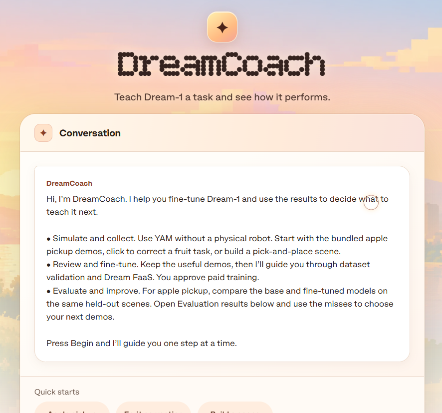
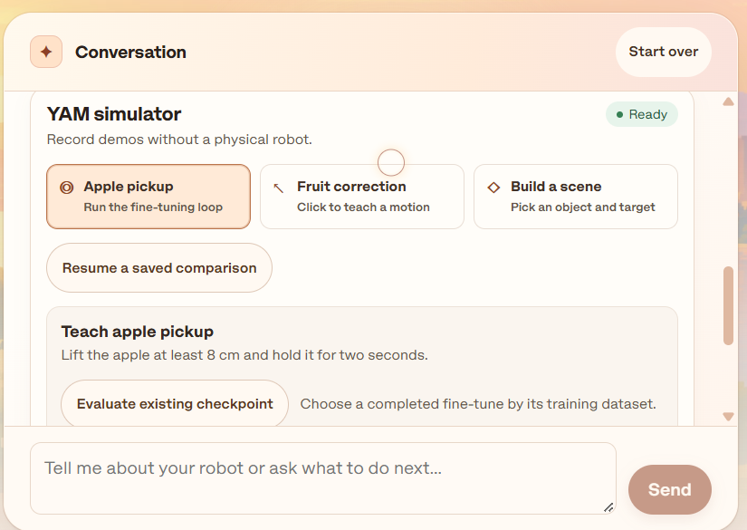
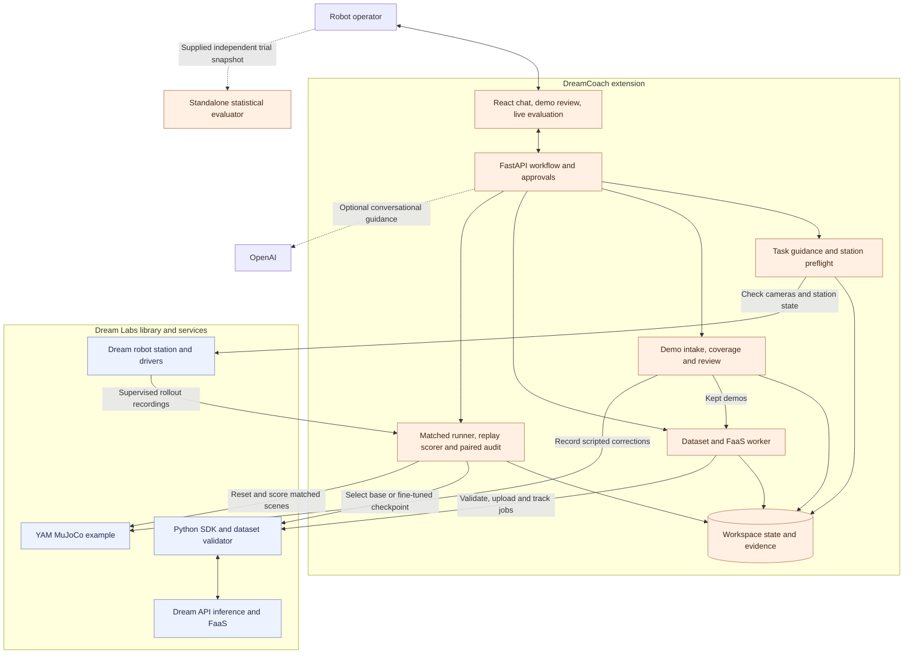
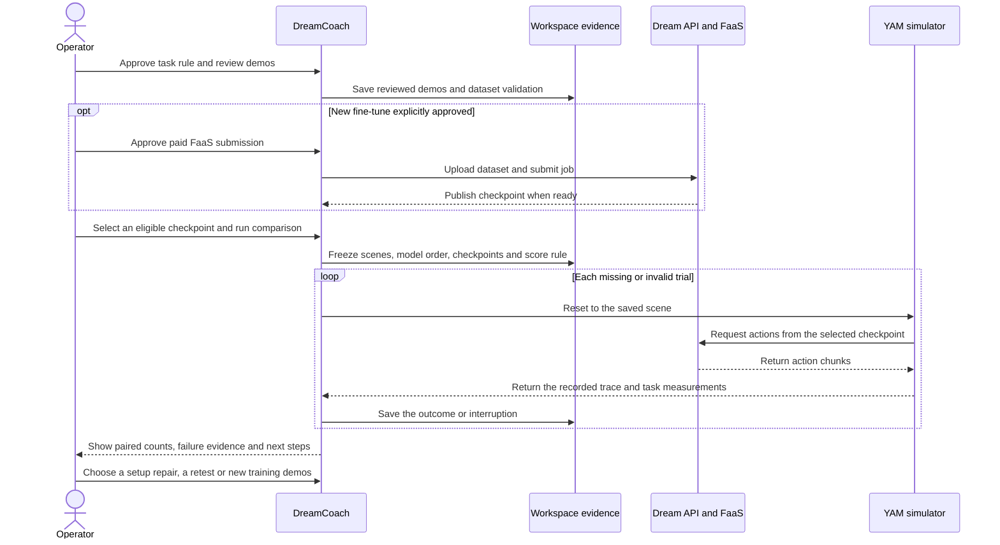
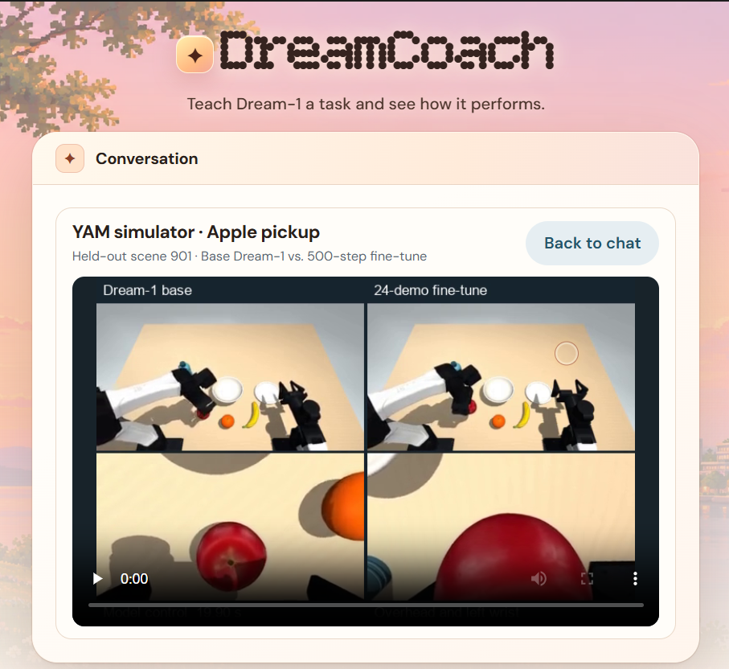
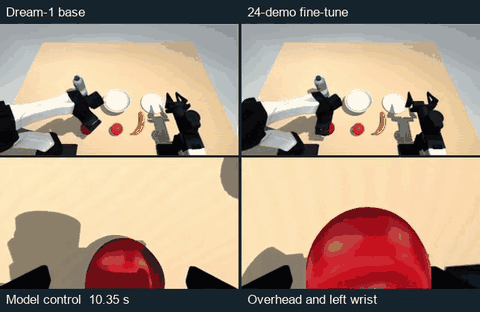

# DreamCoach

An open-source workflow for diagnosing Dream-1 runs, collecting task demonstrations, and verifying fine-tuned checkpoints.

[](https://dreamcoach-161-35-77-34.sslip.io/)
[](coach/pyproject.toml)
[](coach/experiments/yam_sim_faas/README.md)
[](LICENSE)

[Workflow](#what-dreamcoach-adds) · [Architecture](#system-design) · [Research results](#research-results) · [Technical setup](#technical-setup)

## The customer pain point

**When a robot fails a task, its operator needs to know what to fix before paying to train again.** A missed grasp, stale camera feed, and evaluation that stops mid-lift can all produce a failed run. Without usable evidence, operators have to guess whether to repair the setup, demonstrate a specific motion, or give an existing checkpoint a fairer test. Guessing can mean recording more data or spending FaaS credits on the wrong problem.

DreamCoach gives a robotics builder one workflow to inspect the failure, choose the next demonstration or repair, and compare the resulting checkpoint against Dream-1 on scenes reserved for evaluation.

<p align="center">
  
</p>

## What Dream Labs provides

Dream Labs builds **Dream-1**, a World Action Model that uses camera observations, robot state, and a task instruction to produce robot actions. Dream Labs hosts inference through the Dream API. Its **Fine-tuning as a Service (FaaS)** adapts a checkpoint using a demonstration dataset and makes the resulting model available through the same API. [Dream-1 research and FaaS](https://dreamlabs.ai/research/dream-1/) · [Dream API documentation](https://platform.dreamlabs.ai/api-documentation)

The upstream open-source library provides the Python SDK, dataset validation, robot station and driver interfaces, and a YAM MuJoCo example. DreamCoach uses those interfaces for inference, demonstration validation, training, and simulator execution. [Upstream library](dream_library/README.md) · [Python SDK and fine-tuning](dream_library/dream_client/README.md) · [Robot station](dream_library/robots/README.md)

## What DreamCoach adds

| Stage | What the extension does |
| --- | --- |
| **Connect and define the task** | A chat coach checks Dream API access, reads available models, datasets, and jobs, and drafts an instruction and observable success rule for the operator to approve. |
| **Diagnose the baseline** | Station preflight checks camera freshness, arm readiness, and recorded faults. **Repair first** compares a prompt or setup change on matched diagnostic scenes with the same checkpoint. Simulator trace review explains approach, gripper timing, contact, lift, and trial interruptions. |
| **Collect and review demonstrations** | Import LeRobot episodes, record with a supervised local SO-101 setup, or generate scripted YAM corrections without hardware. Review camera clips and quality findings in chat, keep or redo each demo, and prioritize start positions with failures and sparse coverage. |
| **Fine-tune with approval** | Freeze the kept demos into a versioned dataset, run Dream’s validator, and submit to FaaS after approval. Track dataset processing, training, and checkpoint readiness. Retry eligible processing failures on the same upload or explicitly continue a compatible constant-schedule job. |
| **Evaluate and iterate** | Reuse a compatible checkpoint or test a new one. Both models get the same held-out scenes and success rule. Follow live paired counts, inspect per-run diagnoses, and decide whether to fix the setup, adjust the evaluation protocol, or record targeted corrections on fresh training scenes. |

**Resume a saved comparison** reopens the frozen scene list, checkpoint IDs, run order, and valid scores after a stop or restart. It recovers complete local recordings where possible and runs only missing or invalid trials. Earlier interruptions stay visible. New model trials can consume Dream inference credits. [Coach guide](coach/README.md) · [Repair-first workflow](coach/REPAIR_FIRST.md)

### Work without a physical robot

<p align="center">
  
</p>

| YAM workflow | Starting point |
| --- | --- |
| **Apple pickup** | Use 24 bundled demos or run the base checkpoint on fresh training scenes. The failure-conditioned collector selects recorded misses and produces checked, scripted corrective trajectories. [Collector](coach/experiments/yam_sim_faas/FAILURE_CONDITIONED_SIM.md) |
| **Fruit correction** | Select a fruit for a lift or select the apple and bowl for placement. Review the three camera views and keep verified demonstrations. [Fruit tasks](coach/experiments/yam_sim_faas/CLICK_TO_CORRECT.md) |
| **Build a scene** | Start with a red block or yellow ball preset, or configure a supported object and target. Preview, record, and review the scene in chat. [Scene builder](coach/experiments/yam_sim_faas/SCENE_TASK_POC.md) |

Automatic YAM scoring supports **apple pickup**, which requires an 8 cm lift held for two continuous seconds, and **apple into bowl**, which requires an 8 cm lift followed by release and a settled apple inside the bowl for the final second. Bowl comparisons use a joint-space checkpoint with verified bowl-training provenance. Other task definitions can use operator-reviewed physical trials. [Simulator workflows and scoring](coach/README.md) · [Bowl success rule](coach/src/teach_task_coach/yam_goals.py)

## System design

### How the extension fits into Dream Labs



### How a comparison closes the loop



## Evaluation and failure diagnosis

The paired simulator runner compares checkpoints on matched scenes and checks that action replay agrees with recorded robot state. For apple pickup it can distinguish a poor approach, mistimed closure, contact without a sustained lift, and a trial that ended while the apple was still rising. Technical interruptions, safety stops, and unverifiable recordings are visible separately from completed task misses. Saved traces can be diagnosed without new Dream inference. [Per-run diagnostic implementation](coach/experiments/yam_sim_faas/grasp_training/rollout_diagnosis.py) · [Paired evidence contract](coach/PAIRED_EVIDENCE.md)

| Evaluation design | Output |
| --- | --- |
| **Matched simulator scenes** | Paired counts, observed success-rate difference, replay checks, and per-scene diagnoses. Results are descriptive for the tested scenes. |
| **Prospective matched physical scenes** | Reviewed outcomes, reset and holdout attestations, recorded metadata, interventions, response time, and safety stops. A complete audit can estimate a conservative paired interval. Promotion requires an eligible verdict and explicit operator action. |
| **Independent physical trials** | The standalone `dream-eval` engine checks eligibility and estimates the success-rate difference with an interval and verdict. It expects prospective, held-out, human-reviewed independent attempts in one scenario, with a fixed horizon or predeclared interim looks. |

Incomplete or unsuitable evidence can return `not_evaluable` with counts and reasons. Both audit paths preserve evidence and produce checksums for reproducible review. [Paired audit](coach/PAIRED_EVIDENCE.md) · [Independent evaluator](src/dreamlab/evaluation/README.md) · [Statistical audit in DreamCoach](coach/STATISTICAL_AUDIT.md)

## Research results

**A fine-tune can appear to fail when the evaluation ends before its task can finish.** In the first apple pickup pilot, the nine-request cutoff stopped several runs while the apple was still rising. Another attempt stopped on a small gripper command overshoot. The corrected simulator evaluation allowed twelve requests for both models and clamped small finite overshoots to the gripper range while retaining stops for larger violations. Scoring checked sustained height. [Original pilot](coach/experiments/yam_sim_faas/grasp_training/HELDOUT_500_STEP_EVAL.md) · [Corrected evaluation and replay checks](coach/experiments/yam_sim_faas/grasp_training/EXTENDED_500_STEP_EVAL.md)

| Study | Observed passes | What it tested |
| --- | --- | --- |
| [Original matched pilot](coach/experiments/yam_sim_faas/grasp_training/HELDOUT_500_STEP_EVAL.md) | Base **0/4**, fine-tune **1/4** | The shorter trial budget cut lifts short. One attempt stopped on a gripper command. |
| [Fresh held-out comparison](coach/experiments/yam_sim_faas/grasp_training/EXTENDED_500_STEP_EVAL.md) | Base **0/4**, same fine-tune **4/4** | Whether the existing 500-step checkpoint passed under the corrected protocol on four new scenes. |
| [Separately trained checkpoint](coach/experiments/yam_sim_faas/grasp_training/SECOND_ACCOUNT_500_STEP_EVAL.md) | Base **0/4**, second fine-tune **4/4** | Whether a separate 24-demo dataset and 500-step checkpoint showed a gain on another four fresh scenes. |
| [Eight-scene horizon study](coach/experiments/yam_sim_faas/CLOSED_LOOP_REPAIR_STUDY.md#result-on-fresh-scenes-913920) | **7/8** at nine requests, **8/8** at twelve | Separate rollouts from a single unchanged checkpoint under two evaluation horizons. |
| [Predeclared same-trajectory confirmation](coach/experiments/yam_sim_faas/CLOSED_LOOP_REPAIR_STUDY.md#independent-confirmation) | **14/19** at nine requests, **19/19** at twelve | Both budgets scored from the same saved trajectories. Five valid trajectories first passed on request ten or eleven. One of 20 planned attempts was invalid and retained. |

**What DreamCoach contributed.** The extension surfaced the cutoff problem, applied a task-level success rule, and measured improvement already present in the trained checkpoint. The confirmation compared prefixes of the same recordings, so the model weights and earlier actions were identical. Retesting required no new FaaS job. Longer trials execute more actions. Physical reliability, savings in operator time or training spend, and the benefit of failure-conditioned collection at a fixed budget remain open questions. [Observed study and protocols](coach/experiments/yam_sim_faas/CLOSED_LOOP_REPAIR_STUDY.md) · [Prospective operator study design](coach/benchmark/README.md)

### Watch the apple pickup comparison

<p align="center">
  <a href="coach/experiments/yam_sim_faas/grasp_training/full-901/comparison.mp4"></a>
</p>

The overhead and wrist views show the same held-out scene. In this 20-second comparison, the base model peaked at **7.91 cm** and returned the apple to its settled height. The fine-tune sustained an unsupported two-finger hold above **8 cm** for **2.05 seconds**. The screenshot shows the replay in a local DreamCoach chat preview. [Watch the full MP4](coach/experiments/yam_sim_faas/grasp_training/full-901/comparison.mp4) · [Scene 901 protocol, traces, and report](coach/experiments/yam_sim_faas/grasp_training/full-901/README.md)

<details>
<summary>Watch an animated preview of the grasp and lift</summary>



</details>

## Repository map

| Path | Contents |
| --- | --- |
| [`coach/frontend/`](coach/frontend/) | React and TypeScript conversation, simulator controls, and evaluation views |
| [`coach/src/teach_task_coach/`](coach/src/teach_task_coach/) | FastAPI service, simulator workflow, FaaS worker, and paired audit |
| [`coach/experiments/yam_sim_faas/`](coach/experiments/yam_sim_faas/README.md) | YAM collectors, replay tools, frozen protocols, and measured results |
| [`src/dreamlab/evaluation/`](src/dreamlab/evaluation/README.md) | Standalone statistical evaluator and CLI |
| [`dream_library/`](dream_library/README.md) | Upstream Dream Labs SDK, robot station, and examples |

DreamCoach is available under [Apache 2.0](LICENSE). Vendored packages, robot models, and other third-party assets retain their respective licenses. [Third-party notices](dream_library/THIRD-PARTY-LICENSES.md)

## Technical setup

### Run DreamCoach locally

Install Git, [uv](https://docs.astral.sh/uv/), and Node.js with npm. The commands use the pinned Python and dependency versions in the repository.

```sh
git clone https://github.com/tureisD/DreamLabHack.git
cd DreamLabHack/coach
uv sync --locked --group dev --extra sim
cd frontend
npm ci
npm run build
cd ..
uv run --locked --extra sim teach-task-coach serve
```

Open [DreamCoach on localhost](http://127.0.0.1:8765). Choose a simulator quick start or select **Begin**. For live Dream inference and training, create a Dream Labs API key and paste it into the masked connection field. The server validates Dream API access. Set `OPENAI_API_KEY` on the local server to enable AI chat. Keep API keys out of chat and Git. [Dream API keys](https://platform.dreamlabs.ai/api-keys) · [Local configuration](coach/README.md#run-locally)

For a scripted walkthrough with no account or hardware, use the [isolated offline demo](coach/README.md#offline-apple-pickup-walkthrough).

### Run the standalone evaluator

Run from the repository root on Linux for CLI artifact publication. The fixture is synthetic and requires no credentials. Use a new output directory.

```sh
uv sync --locked --extra eval --group dev
uv run --locked --extra eval dream-eval evaluate \
  --input tests/fixtures/evaluation_request.json --output-dir example-run
```

The CLI writes submitted and canonical inputs, a report, a Markdown summary, and a reproducibility manifest. The Python evaluator works on other platforms. [Evaluator API and commands](src/dreamlab/evaluation/README.md) · [Testing and diagnostics](docs/testing-and-diagnostics.md)

### Connect hardware or host the service

For supervised physical trials, connect the Dream robot station, enable rollout recording, and point DreamCoach at the station URL and rollout directory. Use the local coach for hardware actions. The hosted Docker service supports separate account workspaces and persistent storage for simulator runs. [Robot station setup](dream_library/robots/README.md) · [Coach hosting guide](coach/HOSTING.md)
